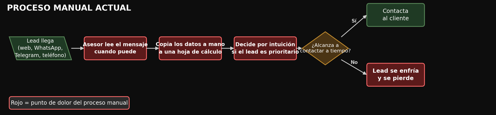
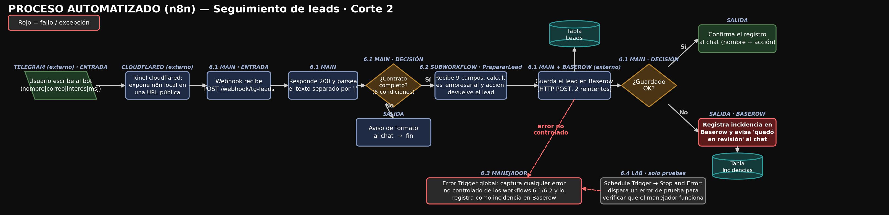

# Seguimiento de Leads — Automatización con n8n

Proyecto del curso **Automatización inteligente de procesos con n8n** (EAM, 2026 II — Corte 2) para **Inmuebles y Apartamentos Inmonova S.A.S**.

Los leads entran por un bot de Telegram, se validan, se clasifican por tipo de correo y nivel de interés, y se registran en Baserow con la acción comercial correspondiente. El asesor recibe la confirmación en el chat y cualquier fallo técnico queda registrado en una tabla de incidencias.

## Integrantes y responsabilidades

| Integrante | Rol | Responsabilidad en esta entrega |
| --- | --- | --- |
| Johan Steven Hernández Torres | Bóveda / Drive | Custodia y respaldo de archivos y evidencias |
| Javier Leonardo Argoty Roa | Desarrollo del workflow | Repositorio, README y diagramas |
| Luis Eduardo Sinisterra Montaño | Pruebas | Bitácora unificada y evidencias |
| Simón David Cruz Suazo | Documentación | Workflows finales, subworkflow y manejador de errores |

## Problema que resuelve

En el escenario sin automatización, un asesor puede recibir leads por formulario web, WhatsApp, Telegram o teléfono y debe leer los mensajes, copiar los datos a una hoja de cálculo y decidir la prioridad manualmente. Esto puede producir demoras, omisiones y errores de digitación. La solución entregada automatiza la recepción por Telegram y permite registrar incidencias para identificar los fallos de guardado.

## Alcance actual

**Disponible:** entrada por webhook de Telegram con respuesta 200 inmediata · validación de los campos obligatorios · clasificación empresarial/personal y por interés (`ALTO`/`MEDIO`/`BAJO`) en un subworkflow reutilizable · acción de seguimiento asignada automáticamente · guardado en Baserow con un reintento · confirmación al chat · registro de incidencias y aviso al usuario si falla el guardado · manejador de errores global.

**Fuera de alcance:** panel de métricas · WhatsApp Business API · autenticación de usuarios finales · notificación por correo o Slack · deduplicación por `update_id` · edición o consulta de leads desde n8n (solo se crean filas).

> Las versiones intermedias del curso (entrada por formulario, workflows 01 a 05) no forman parte de esta entrega: los cuatro JSON de `workflows/` son la versión final.

## Arquitectura

**Proceso manual**

El diagrama muestra cómo una persona puede gestionar contactos de distintos canales sin automatización. La solución automatizada de esta entrega recibe leads **solo por Telegram**.

**Proceso automatizado**

| Workflow | Responsabilidad | Entrada | Salida |
| --- | --- | --- | --- |
| [Seguimiento leads 6.1 - Main.json](<workflows/Seguimiento leads 6.1 - Main.json>) | Orquesta todo: recibe el update, responde 200, parsea y valida el mensaje, invoca el subworkflow, guarda en Baserow y confirma al chat | `POST /webhook/tg-leads` de Telegram | Fila en la tabla de leads + mensaje al chat |
| [Seguimiento leads 6.2 - Subworkflow_PrepararLead.json](<workflows/Seguimiento leads 6.2 - Subworkflow_PrepararLead.json>) | Clasifica el lead: `es_empresarial` y `accion` según interés | 9 campos del lead (`nombre`, `correo`, `interes`, `mensaje`, `canal`, `chat_id`, `update_id`, `submittedAt`, `formMode`) | El mismo lead más `es_empresarial` y `accion` |
| [Seguimiento leads 6.3 - Manejador.json](<workflows/Seguimiento leads 6.3 - Manejador.json>) | Error Trigger global: registra el fallo en la tabla de incidencias | Datos del error de n8n | Fila en incidencias |
| [Seguimiento leads 6.4 - Lab.json](<workflows/Seguimiento leads 6.4 - Lab.json>) | Laboratorio: fuerza un error con `Stop and Error` para probar el manejador | `Schedule Trigger` | Ejecución fallida + fila en incidencias |

## Integraciones

| Servicio | Función | Cómo se usa |
| --- | --- | --- |
| **Telegram Bot API** | Entrada y salida del proceso | Webhook `POST /webhook/tg-leads` para recibir; nodo nativo `Telegram` para responder al chat |
| **Baserow — tabla de leads** | Almacenamiento del lead clasificado | `HTTP Request` `POST /api/database/rows/table/<LEADS_ID>/` con `user_field_names=true` |
| **Baserow — tabla de incidencias** | Registro de fallos técnicos | `HTTP Request` `POST /api/database/rows/table/<INCIDENCIAS_ID>/` con `user_field_names=true` |

## Requisitos

- **n8n** 2.35.7 self-hosted (`n8n start`, `http://localhost:5678`) y **Node.js** 24.x.
- **cloudflared** instalado (solo para el túnel del webhook).
- Bot de Telegram creado en `@BotFather`.
- Cuenta de Baserow con token de API con permiso de escritura sobre las dos tablas.
- Credenciales en n8n: `Telegram account` (`telegramApi`) y una credencial `baserowTokenApi` para cada token de Baserow.

## Configuración

1. **Tabla de leads** con las columnas `nombre`, `correo`, `interes`, `mensaje`, `canal`, `submittedAt`, `formMode`, `es_empresarial` (booleano) y `accion`. `interes` debe tener las opciones `ALTO`/`MEDIO`/`BAJO`; `canal` debe incluir `Telegram`; `formMode` debe incluir `test` (valor que envía el workflow al guardar). Los valores de selección son exactos: si falta uno, Baserow responde `400 ERROR_REQUEST_BODY_VALIDATION`.
2. **Tabla de incidencias** con las columnas `fecha`, `workflow`, `ejecucion_id`, `ejecucion_url`, `nodo`, `mensaje`, `estado` y `accion` (todas de texto, salvo que se quiera usar fecha).
3. **Credenciales en n8n**: crear las credenciales con tokens propios. Los JSON traen nombres de credencial del equipo, pero no sus valores.
4. **Token del bot**: crear un `.env` local en `workflows/` con `TG_TOKEN=<token>`. Está excluido por `.gitignore`; en el repositorio solo viaja `.env.example`.

## Importación y conexiones

1. Importar los cuatro JSON de `workflows/` con *Import from File*. Importar **primero 6.2** (subworkflow) y **6.3** (manejador); después 6.1 y 6.4.
2. En 6.1, abrir el nodo `PrepararLead'` y volver a seleccionar el subworkflow 6.2: al importar, la referencia al ID anterior se pierde.
3. Reasignar las credenciales en `Aviso de formato al chat`, `Confirmar registro al chat` y `Aviso de error al registrar` (Telegram), y en los tres nodos HTTP (`HTTP · Guardar fila Baserow1`, `HTTP Registrar Incidente` y el `HTTP Request` del manejador), que pueden usar tokens distintos.
4. Reemplazar los IDs de tabla en las URLs (`/api/database/rows/table/<ID>/`) y conservar la query `user_field_names=true`.
5. En la instalación utilizada para las pruebas, **publicar primero 6.2 y 6.3**: n8n exigió el subworkflow publicado y deshabilitó el manejador mientras no estaba publicado. En 6.1 y 6.4: *⋯ → Settings → Error Workflow* → seleccionar el manejador 6.3 propio y guardar.
6. Publicar **6.1** después de configurar sus dependencias. Publicar también cualquier cambio posterior de credenciales o referencias. El 6.3 recibe los errores por Error Trigger; el 6.4 debe quedar **sin publicar** salvo durante la prueba de fallo.

## Ejecución

**Funcionamiento habitual (Telegram)**

1. `n8n start` en una terminal.
2. Tener el workflow 6.1 **activo**.
3. En otra terminal: `cd workflows && ./iniciar_bot.sh`. El script levanta el túnel, espera la URL pública, registra el webhook y muestra `Telegram respondió: {"ok":true,...}`.
4. Escribir al bot con el formato `Nombre | correo | ALTO, MEDIO o BAJO | mensaje`.
5. Verificar la confirmación en el chat y la fila nueva en la tabla de leads.

**Prueba en el editor**

- Usar la URL de prueba (`/webhook-test/tg-leads`) solo con *Execute workflow* activo; la de producción (`/webhook/tg-leads`) requiere el workflow activo y es la que se registra en Telegram.
- La URL del túnel es temporal: cambia en cada ejecución y deja de existir al cerrar el proceso.

**Detener todo**

- `Ctrl+C` en la terminal del túnel.
- Desactivar 6.1 en n8n y confirmar que 6.4 (Schedule Trigger) está inactivo.

## Prueba de ejemplo

**Caso normal (ejecución automática)**

| Campo | Valor |
| --- | --- |
| Entrada | `Prueba Uno \| prueba.uno@empresa.com \| ALTO \| Quiero agendar una visita` |
| Pasos | Activar 6.1 → `./iniciar_bot.sh` → enviar el mensaje al bot |
| Resultado esperado | Chat: `Lead registrado: Prueba Uno \| Acción: Notificacion inmediata`. Fila en Baserow con `es_empresarial: true`, `canal: Telegram`, `formMode: test` |
| Resultado observado | Subworkflow con `es_empresarial: true` y acción inmediata, fila visible 69 en Baserow y confirmación recibida en Telegram. [Prueba P01 y capturas](documentacion/Bitacora_Unificada_Proyecto.md#p01--caso-normal-empresarial-e-interés-alto). |

**Entrada inválida (automática)**

Enviar `Prueba | sin-arroba | ALTO | mensaje`: `Contrato completo?` corta el flujo, el chat recibe el formato esperado y no se crea ninguna fila.

**Fallo técnico controlado**

| Campo | Valor |
| --- | --- |
| Pasos | Activar 6.4 → su `Schedule Trigger` corre **cada minuto** → revisar la tabla de incidencias → **desactivar 6.4** |
| Ejecución | Automática (agendada) |
| Resultado esperado | `Stop and Error` falla, el manejador 6.3 registra la incidencia con `nodo: Stop and Error` y `estado: pendiente_revision` |
| Resultado observado | Ejecución automática 55 del laboratorio fallida en `Stop and Error`; el manejador obtuvo una respuesta de creación de incidencia con ID 5 y `estado: pendiente_revision`. [Prueba P09 y capturas](documentacion/Bitacora_Unificada_Proyecto.md#p09--error-automático-y-manejador-global). |

## Errores y recuperación

- **Mensaje inválido**: es una respuesta del negocio. No se guarda y el chat recibe el formato esperado.
- **Fallo al guardar en Baserow**: el nodo hace 2 intentos (1 reintento, 2 s de espera). Si igual falla, la rama de error registra la incidencia y avisa al usuario (`Tu lead quedó en revisión por un error técnico`). La recuperación es corregir la causa (por ejemplo, una opción inexistente en una columna de selección) y reenviar el lead.
- **Error no controlado en cualquier nodo**: lo captura el manejador 6.3 y lo deja en la tabla de incidencias con workflow, ejecución, nodo y mensaje. Si esa tabla no existe o la credencial es incorrecta, el manejador falla y no queda registro.
- **Túnel caído o URL vencida**: no genera error visible porque Telegram deja de entregar updates; se vuelve a ejecutar `iniciar_bot.sh`.
- **Duplicados**: no hay deduplicación por `update_id` y los reintentos pueden duplicar una fila si el POST se completó pero la respuesta se perdió. Antes de reintentar, revisar la tabla de leads.

## Documentación y evidencias

- [Bitácora unificada cerrada](documentacion/Bitacora_Unificada_Proyecto.md): resultados observados, procedimientos, conclusiones y 22 capturas de la jornada del 25 de octubre de 2026, con sus limitaciones documentadas.
- Presentación en PDF: `documentacion/Presentacion_Corte_2.pdf` *(pendiente)*
- Diagramas: [Proceso manual](documentacion/diagramas/Diagrama1_Proceso_Manual_Corte2.png) · [Proceso automatizado](documentacion/diagramas/Diagrama2_Proceso_Automatizado_Corte2.png) · Evidencias: [`documentacion/evidencias/`](documentacion/evidencias) · Workflows: [`workflows/`](workflows)

## Estado del proyecto

| Clasificación | Elementos |
| --- | --- |
| **Implementado** | Flujo completo por Telegram: validación del mensaje, subworkflow de clasificación, acción asignada, guardado en Baserow, confirmación al chat y registro de errores con aviso al usuario. |
| **Simulado** | Pruebas con leads ficticios y fallo forzado con el workflow 6.4. Sin tráfico real de producción. |
| **Propuesto** | Deduplicación por `update_id`, lectura y actualización de leads, WhatsApp Business API y panel de métricas. |

## Acceso al proyecto

<https://github.com/Argoty/SeguimientoLeads-N8N>
