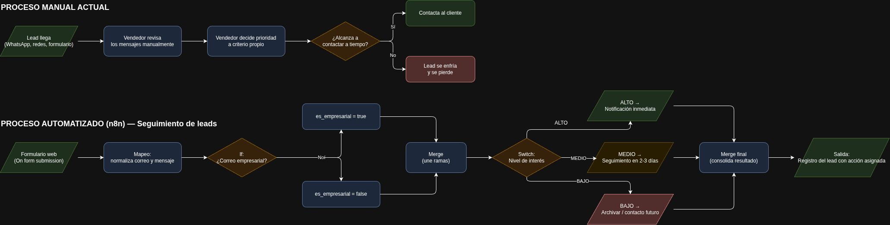

# Seguimiento de Leads — Automatización con n8n

Proyecto del curso **Automatización inteligente de procesos con n8n** (EAM, 2026 II — Corte 2) para **Inmuebles y Apartamentos Inmonova S.A.S**.

Sistema que captura leads por formulario o Telegram, los valida, los clasifica por nivel de interés y tipo de correo, y los registra en Baserow con la acción comercial correspondiente. El asesor recibe la confirmación por Telegram.

## Integrantes y responsabilidades

| Integrante | Rol | Responsabilidad en esta entrega |
| --- | --- | --- |
| Johan Steven Hernández Torres | Bóveda / Drive | Custodia y respaldo de archivos y evidencias |
| Javier Leonardo Argoty Roa | Desarrollo del workflow | Repositorio, README y diagramas |
| Luis Eduardo Sinisterra Montaño | Pruebas | Bitácora unificada y evidencias |
| Simón David Cruz Suazo | Documentación | JSON finales de los workflows y subworkflow |

## Problema que resuelve

Los leads llegan por distintos canales (formulario web, WhatsApp, Telegram, teléfono) sin un proceso centralizado. Nadie sabe cuál es prioritario, los de interés alto se enfrían antes de ser atendidos y el registro manual en una hoja de cálculo produce omisiones y errores de tipeo.

## Alcance actual

**Disponible:** entrada por formulario y por webhook de Telegram · validación de campos obligatorios · normalización de correo y mensaje · clasificación empresarial/personal y por interés (`ALTO`/`MEDIO`/`BAJO`) · acción automática de seguimiento · guardado en Baserow · confirmación y aviso de formato por Telegram.

**Fuera de alcance:** panel de métricas · WhatsApp Business API · autenticación de usuarios · notificación por correo o Slack · deduplicación por `update_id` · manejador de errores persistente.

## Arquitectura



```text
Formulario n8n ──┐
                 ├─> Validación → Tipo de correo → Interés → Acción → Baserow → Confirmación
Telegram (webhook) ┘
```

| Workflow | Responsabilidad |
| --- | --- |
| `Workflow_01_DatosValidacion.json` | Campos de un lead simulado y validación de correo e interés |
| `Workflow_02_LogicaControlFlujo.json` | Filtro de campos, tipo de correo y clasificación por interés sobre 10 leads de prueba |
| `Workflow_03_Formulario.json` | Entrada por `Form Trigger` con normalización de datos |
| `Workflow_04_API.json` | Guardado del lead clasificado en Baserow |
| `Workflow_05_WebhookTelegram.json` | Entrada por Telegram: respuesta 200, parseo, validación, clasificación, guardado y confirmación |
| Subworkflow *(pendiente)* | Reutilización de una responsabilidad concreta con entradas y salidas definidas |

> Los JSON finales y el subworkflow los está consolidando Simón; todavía no están en `workflows/`.

## Requisitos

- **n8n** 2.35.7 self-hosted (`n8n start`, `http://localhost:5678`) y **Node.js** 24.x.
- **cloudflared** para exponer n8n al probar el webhook.
- Bot de Telegram creado en `@BotFather` y cuenta de Baserow con token de API.
- Credenciales en n8n: `Telegram account` (`telegramApi`) y `Baserow Token account` (`baserowTokenApi`).

## Configuración

1. **Baserow**: crear la tabla con las columnas `nombre`, `correo`, `interes`, `mensaje`, `canal`, `submittedAt`, `formMode`, `es_empresarial` (booleano) y `accion`. `interes` (selección) debe tener `ALTO`/`MEDIO`/`BAJO`, `canal` debe incluir `Telegram`, y `formMode` debe incluir `test`. Los valores de selección son exactos: si falta uno, Baserow responde `400 ERROR_REQUEST_BODY_VALIDATION`.
2. **Credenciales en n8n**: crear las dos credenciales con los tokens propios. No van en los JSON.
3. **Token del bot**: crear un `.env` local junto al script del túnel con `TG_TOKEN=<token>`. Está excluido por `.gitignore`; este repositorio no contiene secretos.

## Importación y conexiones

1. Importar los JSON de `workflows/` con *Import from File*; el subworkflow se importa antes que el workflow que lo invoca.
2. Reasignar las credenciales en `Aviso de formato al chat`, `Confirmar registro al chat` y `HTTP · Guardar fila Baserow1`.
3. Reemplazar el ID de la tabla en la URL del nodo HTTP (`/api/database/rows/table/<ID>/`) por el de la tabla propia y conservar la query `user_field_names=true`.
4. Asociar el manejador de errores en *Settings → Error Workflow* si se usa.

## Ejecución

**Formulario**

1. Ejecutar el `Form Trigger` de `Workflow_03_Formulario.json` o `Workflow_04_API.json`.
2. Completar con datos ficticios y verificar el OUTPUT y la fila en Baserow.

**Telegram**

1. `n8n start` en una terminal.
2. Activar `Workflow_05_WebhookTelegram.json`.
3. En otra terminal: `./iniciar_bot.sh` (levanta el túnel y registra el webhook; esperar `Telegram respondió: {"ok":true,...}`).
4. Enviar al bot: `Nombre | correo | ALTO, MEDIO o BAJO | mensaje`.

**Detener**: `Ctrl+C` en el túnel y desactivar el workflow. La URL del túnel es temporal: cambia en cada ejecución y deja de existir al cerrarlo, por eso el script registra el webhook cada vez. La URL de prueba (`/webhook-test/tg-leads`) solo escucha mientras se ejecuta el workflow en el editor; la de producción (`/webhook/tg-leads`) requiere el workflow activo.

## Prueba de ejemplo

| Campo | Valor |
| --- | --- |
| Entrada | `Prueba Uno \| prueba@empresa.com \| ALTO \| Quiero una agenda de visita` |
| Pasos | Activar workflow 5 → `iniciar_bot.sh` → enviar el mensaje al bot |
| Resultado esperado | `Lead registrado: Prueba Uno \| Acción: Notificacion inmediata` y fila en Baserow con `es_empresarial: true`, `canal: Telegram`, `formMode: test` |
| Resultado observado | Pendiente de completar con la evidencia |

## Errores y recuperación

- **Mensaje incompleto o interés inválido**: no se guarda y el chat recibe el formato esperado.
- **Opción inexistente en Baserow** (`400 ERROR_REQUEST_BODY_VALIDATION`): la ejecución se corta en el nodo HTTP sin confirmación; se agrega la opción en la columna y se reenvía.
- **Credencial sin asignar tras importar**: falla el nodo y queda el error registrado en n8n; se reasigna y se reintenta.
- **Túnel cerrado**: no hay error visible porque Telegram deja de entregar; se vuelve a ejecutar el script.
- **Mensaje reenviado**: se crea otra fila (no hay deduplicación); revisar y borrar el duplicado.

## Documentación y evidencias

- Bitácora unificada: `documentacion/Bitacora_Unificada_Proyecto.md` *(pendiente)*
- Presentación en PDF: `documentacion/Presentacion_Corte_2.pdf` *(pendiente)*
- Diagramas: [`documentacion/diagramas/`](documentacion/diagramas) · Evidencias: [`documentacion/evidencias/`](documentacion/evidencias) · Workflows: [`workflows/`](workflows)

## Estado del proyecto

| Clasificación | Elementos |
| --- | --- |
| **Implementado** | Formulario, webhook de Telegram, validaciones, clasificación por correo e interés, acción asignada, guardado en Baserow y confirmación por Telegram. |
| **Simulado** | Leads de prueba manuales y los 10 leads ficticios del workflow 02. Sin tráfico real. |
| **Propuesto** | Subworkflow, manejador de errores con registro persistente, deduplicación por `update_id` y panel de métricas. |

## Acceso al proyecto

<https://github.com/Argoty/SeguimientoLeads-N8N>
