# Bitácora unificada del proyecto — Seguimiento de Leads

**Curso:** Automatización inteligente de procesos con n8n

**Institución:** EAM

**Periodo:** 2026 II — Segundo corte

**Organización del caso:** Inmuebles y Apartamentos Inmonova S.A.S

**Jornada de pruebas y cierre documental:** 25 de octubre de 2026, fecha local de las capturas

**Estado:** cerrada documentalmente para el segundo corte, con limitaciones registradas

**Responsable de pruebas y consolidación:** Luis Eduardo Sinisterra Montaño

**Versión documentada:** workflows 6.1, 6.2, 6.3 y 6.4, reconfigurados en la instalación local para las pruebas

**Repositorio:** <https://github.com/Argoty/SeguimientoLeads-N8N>

> **Cierre documental:** se revisaron e incorporaron 22 capturas reales de Telegram, n8n y Baserow. La sección 8 relaciona entradas, pasos, resultados y conclusiones de las pruebas realizadas. El cierre deja constancia del funcionamiento demostrado y de sus limitaciones; no equivale a una aprobación del docente ni a una certificación de producción.

## 1. Integrantes y responsabilidades

Las responsabilidades corresponden a la distribución registrada en el README del equipo.

| Integrante | Rol | Responsabilidad |
| --- | --- | --- |
| Johan Steven Hernández Torres | Bóveda / Drive | Custodia y respaldo de archivos y evidencias. |
| Javier Leonardo Argoty Roa | Desarrollo del workflow | Repositorio, README y diagramas. |
| Luis Eduardo Sinisterra Montaño | Pruebas | Bitácora unificada y evidencias. |
| Simón David Cruz Suazo | Documentación | Workflows finales, subworkflow y manejador de errores. |

Luis Eduardo Sinisterra Montaño realizó las pruebas guiadas y aportó las capturas de esta jornada. La sección 10 distingue ese trabajo comprobado de las responsabilidades generales declaradas por el equipo.

## 2. Problema, objetivo y alcance

### 2.1. Problema

Un lead es un contacto que expresa interés en un inmueble o en un servicio de la organización. En el escenario manual, una persona puede recibir contactos por web, WhatsApp, Telegram o teléfono y debe leer los mensajes, copiar los datos y decidir a quién atender primero. Esto puede ocasionar demoras, errores de digitación, omisiones y pérdida de oportunidades. La automatización entregada aborda la recepción por Telegram; no integra los demás canales. Cuando falla una integración, también se necesita una forma de identificar el incidente y atenderlo.

### 2.2. Objetivo

Centralizar los leads recibidos por un bot de Telegram, validar sus datos, asignarles una acción según su interés y registrarlos en Baserow. La solución contempla confirmaciones por chat y rutas de tratamiento de errores.

### 2.3. Alcance de la versión entregada

- Recepción de mensajes de Telegram mediante un Webhook, es decir, una dirección HTTP a la que Telegram envía los eventos del bot.
- Respuesta HTTP 200 antes de procesar el lead.
- Separación, limpieza y validación de los datos del mensaje.
- Clasificación del correo y asignación de una acción en un subworkflow, una rutina llamada desde otro workflow.
- Creación de filas en Baserow mediante su API, la interfaz que permite intercambiar datos con el servicio.
- Confirmación al chat cuando el guardado termina sin error.
- Un reintento de guardado y una ruta local de incidencias.
- Manejador global asociado al principal y al laboratorio de fallos.

No se incluyen WhatsApp Business API, un panel de métricas, autenticación de usuarios finales, consulta o edición de leads, deduplicación por `update_id` ni una agenda automática de contactos. Las acciones comerciales son textos asignados al registro: no implican que se haya programado una llamada, archivado el contacto o enviado una alerta independiente al asesor.

## 3. Proceso manual y proceso automatizado

### 3.1. Proceso manual

1. En el escenario sin automatización, el contacto puede llegar por web, WhatsApp, Telegram o teléfono.
2. El asesor lee el mensaje cuando puede atenderlo.
3. Copia los datos a una hoja de cálculo.
4. Decide la prioridad según su criterio.
5. Contacta al cliente si alcanza a hacerlo a tiempo; de lo contrario, el interés puede disminuir.

Los puntos de demora son la lectura pendiente, la copia manual y la decisión de prioridad sin una regla uniforme.


El diagrama representa el escenario de una persona que gestiona los contactos sin automatización. Sus distintos canales de recepción sirven para explicar el problema manual; la solución automatizada descrita y probada a continuación recibe datos únicamente por Telegram.

### 3.2. Proceso automatizado

1. El usuario escribe al bot con el formato definido.
2. Cloudflare Tunnel permite que Telegram alcance el n8n local mediante una URL pública temporal.
3. El principal recibe la petición y responde HTTP 200. Esta respuesta confirma recepción HTTP, no almacenamiento del lead.
4. El parser transforma el mensaje y el IF comprueba las condiciones obligatorias.
5. Si la entrada es inválida, se intenta enviar una instrucción de formato y no se crea el lead.
6. Si es válida, el principal llama al subworkflow de clasificación.
7. El lead enriquecido se envía a Baserow.
8. Si el guardado no genera error, se confirma al chat. Si falla después del reintento, se intenta registrar la incidencia y luego avisar al usuario.
9. Un error no controlado que haga fallar una ejecución automática del principal puede activar el manejador asociado.


**Aclaración del diagrama:** donde dice «2 reintentos», la configuración real del nodo es **2 intentos totales: el inicial y 1 reintento**, separados por 2 segundos. El manejador está asociado directamente a 6.1 y 6.4; un fallo del subworkflow debe propagarse al principal para ser atendido por esa asociación.

## 4. Organización de los workflows

| Archivo | Responsabilidad | Entrada | Salida |
| --- | --- | --- | --- |
| [6.1 — Main](<../workflows/Seguimiento leads 6.1 - Main.json>) | Recibir, validar, llamar al subworkflow, guardar y responder. | Update de Telegram por `POST /webhook/tg-leads`. | Registro y confirmación, rechazo de formato o ruta de error. |
| [6.2 — PrepararLead](<../workflows/Seguimiento leads 6.2 - Subworkflow_PrepararLead.json>) | Clasificar el correo y asignar la acción por interés. | Los nueve campos del lead. | El lead con `es_empresarial` y `accion`. |
| [6.3 — Manejador](<../workflows/Seguimiento leads 6.3 - Manejador.json>) | Preparar y guardar el registro de un fallo automático no controlado. | Metadatos recibidos por Error Trigger. | Petición de creación de una incidencia en Baserow. |
| [6.4 — Lab](<../workflows/Seguimiento leads 6.4 - Lab.json>) | Provocar un fallo para comprobar la asociación del manejador. | Ejecución programada cada minuto durante la prueba. | Error intencional de `Stop and Error`. |

La separación permite mantener la clasificación fuera de la orquestación y utilizar un manejador común. El laboratorio es independiente del registro normal de leads y debe permanecer inactivo fuera de la prueba.

## 5. Datos, transformaciones y decisiones

### 5.1. Formato de entrada

```text
Nombre | correo | ALTO, MEDIO o BAJO | mensaje
```

Ejemplo ficticio:

```text
Prueba Uno | prueba.uno@empresa.com | ALTO | Quiero agendar una visita
```

El parser utiliza `body.message.text`, `body.message.chat.id`, `body.message.date` y `body.update_id` del update recibido por el Webhook.

### 5.2. Contrato del lead

| Campo | Origen y transformación | Validación del principal |
| --- | --- | --- |
| `nombre` | Primer segmento, sin espacios externos. | No vacío. |
| `correo` | Segundo segmento, sin espacios externos y en minúsculas. | Contiene `@`. No es una validación completa de correo. |
| `interes` | Tercer segmento, sin espacios externos y en mayúsculas. | Debe ser `ALTO`, `MEDIO` o `BAJO`. |
| `mensaje` | Segmentos restantes unidos por ` \| `. | No vacío. |
| `canal` | Valor fijo `Telegram`. | No hay condición adicional. |
| `chat_id` | Identificador del chat; `null` si no existe. | Su representación textual no debe estar vacía. |
| `update_id` | Identificador del evento; `null` si no existe. | No se valida ni se usa para deduplicar. |
| `submittedAt` | Fecha de Telegram convertida a ISO; si falta, fecha del procesamiento. | No hay condición adicional. |
| `formMode` | Valor fijo `telegram` en el parser. | El HTTP de guardado lo reemplaza por `test`. |

El principal envía estos nueve campos al subworkflow. La validación de obligatoriedad está en el principal; el subworkflow no repite una validación completa de su contrato.

### 5.3. Expresiones importantes

| Expresión o transformación | Propósito | Ejemplo de entrada → salida |
| --- | --- | --- |
| `.trim().split('\|').map(p => p.trim())` | Separar el texto y quitar espacios externos de cada segmento. | ` Ana \| ANA@EMPRESA.COM \| alto \| Visita ` → segmentos sin espacios externos. |
| `correo.toLowerCase()` | Uniformar el correo. | `ANA@EMPRESA.COM` → `ana@empresa.com`. |
| `interes.toUpperCase()` | Uniformar la categoría. | `alto` → `ALTO`. |
| `resto.join(' \| ')` | Conservar los separadores que aparezcan dentro del mensaje. | `Visita \| mañana` → `Visita \| mañana`. |
| `['ALTO','MEDIO','BAJO'].includes($json.interes)` | Comprobar que el interés pertenece al catálogo. | `MEDIO` → `true`; `URGENTE` → `false`. |
| `new Date(msg.date * 1000).toISOString()` | Convertir los segundos del evento en una fecha ISO. | `1` → `1970-01-01T00:00:01.000Z`. Si la fecha falta, el parser usa la fecha actual. |
| `$json.execution?.error?.message \|\| 'Error sin mensaje'` | Obtener el mensaje del fallo o un texto alternativo. | Un error con `message: 'Fallo controlado'` → `Fallo controlado`. |

### 5.4. Clasificación y salida del subworkflow

La condición de correo empresarial exige que el correo **no contenga** `@gmail`, `@hotmail` ni `@outlook`. Si cumple las tres comparaciones, agrega `es_empresarial: true`; en caso contrario, `false`.

Esta regla es una aproximación: no identifica todos los proveedores personales ni compara un catálogo completo de dominios. Por ejemplo, un correo de Yahoo queda clasificado como empresarial por la regla actual.

| Interés | Valor de `accion` | Efecto real |
| --- | --- | --- |
| `ALTO` | `Notificacion inmediata` | Asigna el texto; no envía una alerta comercial adicional. |
| `MEDIO` | `Registrar seguimiento en 2 o 3 dias` | Asigna el texto; no programa una tarea futura. |
| `BAJO` | `Archivar, contactar en el futuro` | Asigna el texto; no ejecuta una operación de archivado. |

Los nodos de asignación conservan los otros campos. El Merge final recibe las tres rutas y su resultado vuelve al principal. P01 y P02 muestran directamente la salida de la llamada; las confirmaciones de P03 y P05 muestran las acciones de las otras dos rutas. El principal utiliza el resultado del subworkflow antes de guardar y confirmar.

## 6. Integraciones y configuración reproducible

### 6.1. Entorno y recursos

El README declara n8n **2.35.7 self-hosted** y Node.js **24.x**. Los registros de la sesión muestran Node.js **24.22.1**; no se adjuntó una salida de versión de n8n que permita confirmar independientemente su número exacto. La interfaz utilizada distingue **Publish** de la escucha manual de pruebas.

Se necesitan:

- n8n local accesible en `http://localhost:5678`.
- `cloudflared`, Bash y `curl` para el script del túnel.
- Un bot creado con BotFather y una credencial `telegramApi` en n8n.
- Baserow con un token con permiso para crear filas en las tablas correspondientes.
- Credenciales `baserowTokenApi` reasignadas a los nodos HTTP después de importar.

No se deben escribir valores reales de tokens en esta bitácora ni mostrarlos en las capturas.

### 6.2. Tablas de Baserow

**Leads:** `nombre`, `correo`, `interes`, `mensaje`, `canal`, `submittedAt`, `formMode`, `es_empresarial` y `accion`.

- `es_empresarial`: booleano.
- Si `interes` es selección, incluir `ALTO`, `MEDIO` y `BAJO`.
- Si `canal` es selección, incluir `Telegram`.
- Si `formMode` es selección, incluir `test`, que es el valor enviado actualmente al guardar.

**Incidencias:** `fecha`, `workflow`, `ejecucion_id`, `ejecucion_url`, `nodo`, `mensaje`, `estado` y `accion`. Pueden prepararse como texto; si `fecha` se configura como fecha, debe aceptar el valor ISO enviado.

Los identificadores de tabla de la exportación deben reemplazarse por los de la copia propia.

### 6.3. Operaciones HTTP y Telegram

| Operación | Método y endpoint | Datos enviados y respuesta relevante |
| --- | --- | --- |
| Recibir un update | `POST /webhook/tg-leads` | Body de Telegram con mensaje y metadatos. Respuesta HTTP 200 sin cuerpo antes del procesamiento. |
| Crear un lead | `POST https://api.baserow.io/api/database/rows/table/<LEADS_ID>/?user_field_names=true` | Los nueve campos de la tabla de leads. La respuesta de creación debe permitir comprobar la fila y su identificador. |
| Crear una incidencia local o global | `POST https://api.baserow.io/api/database/rows/table/<INCIDENCIAS_ID>/?user_field_names=true` | Los ocho campos de incidencias. La evidencia debe mostrar la fila creada, no solo el cuerpo preparado. |
| Registrar el webhook del bot | `POST https://api.telegram.org/bot<TG_TOKEN>/setWebhook` | JSON con `url` igual a la URL pública y `/webhook/tg-leads`. El script comprueba `ok: true`. |
| Responder al chat | Nodo nativo Telegram | `chatId`, texto y atribución desactivada. La evidencia debe mostrar el mensaje recibido y el resultado del nodo. |

Los workflows no incluyen consultas de lectura de Baserow ni actualización de filas. Esta limitación debe distinguirse del requisito general de lectura y escritura indicado en la guía del corte. No se implementa paginación porque no hay una consulta paginada en la versión entregada.

### 6.4. Importación y puesta en marcha

1. Importar y guardar 6.2 y 6.3; después importar 6.1 y 6.4.
2. En 6.1, abrir `PrepararLead'` y seleccionar el subworkflow 6.2 de la instalación propia. Comprobar que la llamada espere su resultado.
3. Reasignar las credenciales de los tres nodos Telegram del principal y de los nodos HTTP del principal y del manejador.
4. Reemplazar los IDs de tabla y conservar `user_field_names=true`.
5. Publicar primero **6.2** y **6.3**. En la instalación utilizada, n8n impidió publicar el principal si el subworkflow no estaba publicado y deshabilitó la selección del manejador con el aviso «Not published» mientras 6.3 no estaba publicado.
6. En **⋯ → Settings** de 6.1 y 6.4, seleccionar el 6.3 propio como **Error Workflow**, guardar y publicar los cambios del principal. Mantener 6.4 sin publicar salvo durante la prueba automática. La publicación de 6.3 no le agrega un horario: su entrada sigue siendo Error Trigger.
7. Crear un `.env` local dentro de `workflows/` a partir de `.env.example` y asignar `TG_TOKEN` con el token propio.
8. Iniciar n8n con `n8n start` y, en otra terminal dentro de `workflows/`, ejecutar `./iniciar_bot.sh`.
9. Confirmar que el script muestra `ok: true` y enviar el caso de prueba al bot.

La ruta `/webhook-test/tg-leads` se utiliza solo mientras el editor está escuchando una prueba. La ruta `/webhook/tg-leads` corresponde al principal publicado y es la que registra el script. Las ejecuciones de producción se consultan en **Executions**; no tienen que aparecer en el panel «Listening for test event» del editor.

Para ejecutar un recorrido completo de prueba se utilizó **Execute** desde el lienzo y después una petición a la URL de prueba. La escucha aislada del nodo Webhook solo capturó la entrada en uno de los intentos. Cada nueva petición de prueba requiere volver a iniciar la escucha si esta ya terminó.

La URL del túnel es temporal: cambia al reiniciarlo y deja de estar disponible al cerrarlo. Para detener la demostración, usar `Ctrl+C` en el túnel y desactivar el laboratorio si se activó. El script contiene una referencia histórica a un puente `.cjs`, pero ese puente no forma parte de los archivos entregados; el procedimiento documentado usa el puerto 5678 directo.

## 7. Errores, registro y recuperación

### 7.1. Respuesta del negocio: entrada inválida

Si faltan nombre o mensaje, el correo no contiene `@`, el interés no es válido o falta `chat_id`, el IF toma la salida falsa. Se intenta enviar el formato esperado por Telegram y no se llama al guardado del lead.

Si falta `chat_id`, el aviso tampoco tiene un destino válido y puede fallar técnicamente. Asimismo, un correo como `@` supera la condición actual aunque no sea una dirección válida.

### 7.2. Fallo técnico capturado localmente

`HTTP · Guardar fila Baserow1` tiene `retryOnFail: true`, `maxTries: 2`, `waitBetweenTries: 2000` y `onError: continueErrorOutput`.

Después de agotar los dos intentos, la ruta es:

```text
Salida de error del guardado
    → HTTP Registrar Incidente
    → Aviso de error al registrar
```

El aviso previsto es: «Tu lead quedó en revisión por un error técnico. Lo atenderemos manualmente. Gracias por tu paciencia».

**Límites de esta ruta:**

- El aviso depende de que termine el registro de la incidencia. Si ese registro falla, puede no enviarse el mensaje.
- El registro depende de Baserow, el mismo servicio en el que falló el guardado del lead.
- El cuerpo configurado en `HTTP Registrar Incidente` contiene signos `=` dentro de los valores de una plantilla de expresión. **P08 confirmó su almacenamiento como texto sobrante**, por ejemplo `ejecucion_id: "=60"` y un mensaje que comienza con `=`. La escritura funciona para el caso probado, pero el formato requiere mejora. No se probó un mensaje que contenga comillas para verificar su interpolación.
- La URL utiliza `$execution.resumeUrl`. P08 mostró un enlace de reanudación `webhook-waiting`, no un enlace de consulta de ejecución. Se ocultó ese valor firmado en la captura publicada.
- El campo `workflow` de la incidencia local es un texto fijo del principal. En P08 conserva ese nombre aunque se ejecute la copia de prueba; debe correlacionarse también con la ejecución y el caso.
- La incidencia no conserva el contenido completo del lead ni `update_id`. No demuestra que exista una cola durable de leads pendientes.

P08 comprobó la salida de error, la creación de la incidencia con ID **7** y la entrega del aviso en Telegram. La conclusión es **tratamiento local funcional con observaciones de formato y trazabilidad**, no ausencia de defectos.

### 7.3. Error global no controlado

El manejador 6.3 prepara fecha, workflow, ejecución, URL, nodo, mensaje, estado `pendiente_revision` y acción `Revisar la ejecución y corregir`. Después intenta crear la fila en la tabla de incidencias.

Error Trigger debe probarse mediante una ejecución automática: pulsar **Execute workflow** en el editor no demuestra su activación. El laboratorio 6.4 utiliza un horario de un minuto, asigna `forzar_error: true` y falla con `Stop and Error`.

El manejador no reanuda la ejecución ni corrige la causa. Su mapeo contempla errores dentro de `execution`, pero no conserva específicamente los mensajes de un fallo que llegue solo en `trigger`. Si Baserow falla también en el manejador, el registro persistente puede no crearse.

### 7.4. Recuperación y duplicados

1. Identificar la ejecución y el nodo afectado en n8n, y consultar la incidencia si se creó.
2. Revisar si el lead ya existe en Baserow: una respuesta perdida no demuestra que el POST haya fallado antes de crear la fila.
3. Corregir la causa, por ejemplo credencial, conectividad o valor de una columna de selección.
4. Recuperar los datos desde el chat o el historial disponible y reenviar solo después de comprobar el guardado previo.
5. Verificar la fila y la respuesta al chat. Si corresponde, actualizar manualmente el estado de la incidencia tras resolverla.

No hay deduplicación automática. `update_id` no se persiste y el reintento de un POST puede duplicar filas. La comprobación manual es la medida operativa actual, no una garantía de idempotencia. La disponibilidad del historial depende de la configuración y retención de n8n.

## 8. Pruebas y evidencias

### 8.1. Comprobaciones locales realizadas

Durante la revisión se analizaron los cuatro JSON del proyecto y los cinco ejemplos de clase. Los nueve archivos pudieron interpretarse como JSON y sus conexiones referenciaban nodos existentes. `bash -n workflows/iniciar_bot.sh` terminó sin errores de sintaxis.

También se ejecutó el código del parser de forma aislada y se evaluó una reproducción de las condiciones del IF:

| Entrada ficticia | Resultado observado localmente | Conclusión y alcance |
| --- | --- | --- |
| ` Ana \| ANA@EMPRESA.COM \| alto \| Visita \| mañana ` | Correo `ana@empresa.com`, interés `ALTO`, mensaje `Visita \| mañana`; condiciones reproducidas aceptadas. | Normalización comprobada de forma aislada. No demuestra ejecución de n8n ni escritura externa. |
| `Ana \| @ \| ALTO \| Visita` | Las condiciones reproducidas aceptaron la entrada. | Se identifica la limitación de validar el correo solo por contener `@`. |
| `Ana \| ana@empresa.com \| ALTO` | Mensaje vacío; condiciones reproducidas rechazadas. | La entrada incompleta se identifica localmente. No demuestra entrega del aviso en Telegram. |

Estas comprobaciones complementan las pruebas con capturas siguientes. No se guardaron imágenes de las comprobaciones aisladas ni se realizó una prueba independiente de instalación limpia.

### 8.2. Jornada, modalidades y criterio de evaluación

**Responsable:** Luis Eduardo Sinisterra Montaño. Las capturas de Telegram y Baserow corresponden al **25 de octubre de 2026** en la hora local mostrada. Algunos datos ISO usan UTC y alcanzan el día 26; el manejador muestra además un desplazamiento `-04:00`, distinto del reloj del chat. Para correlacionar P09 se utilizó la ejecución **55**, no la coincidencia literal de horas.

- **P01, P02, P03, P05 y P07A:** mensajes enviados desde Telegram al principal publicado, mediante el túnel. Son ejecuciones automáticas por el Webhook de producción.
- **P08 y P10:** ejecución manual del flujo completo en una copia sin publicar, iniciada con **Execute** y alimentada mediante `curl` a `/webhook-test/tg-leads-prueba`. La salida Telegram sí se entregó al chat. No se describen como entrada real desde Telegram.
- **P09:** ejecución automática por horario de 6.4, con 6.3 publicado y asociado como manejador.
- **C00:** prueba manual de escritura con datos de ejemplo del manejador; no acredita un fallo automático.

Se conservaron los identificadores de la planificación original. P04, P06 y P07B no se ejecutaron como casos integrales separados; se seleccionaron pruebas para cubrir ambos tipos de correo, los tres intereses, una entrada inválida, los dos tratamientos de error y la recuperación. Tampoco se declara aprobada una prueba independiente P11 de importación limpia.

Las conclusiones indican el alcance demostrado. Una confirmación en Telegram acredita la respuesta; una fila visible o una respuesta de creación de Baserow acredita almacenamiento. No se asignan IDs de ejecución que no aparezcan en las evidencias.

### 8.3. Matriz final de resultados

| Caso | Resultado esperado | Resultado observado y referencia | Conclusión |
| --- | --- | --- | --- |
| C00 — Conexión de incidencias | Crear y consultar visualmente una fila de ejemplo. | HTTP exitoso con `id: 4`; la misma fila aparece en Baserow con `Example Workflow`. | **Aprobada:** conexión y escritura, no Error Trigger automático. |
| P01 — Empresarial / ALTO | Clasificar como empresarial, asignar acción inmediata, guardar y confirmar. | Salida `true`, acción inmediata, fila visible **69** y confirmación a las **18:33**. | **Aprobada:** recorrido normal respaldado en los tres sistemas. |
| P02 — Personal / ALTO | Clasificar Gmail como personal y registrar con acción inmediata. | Salida `false`, acción inmediata, fila visible **71** y confirmación a las **18:37**. | **Aprobada:** distinción empresarial/personal. |
| P03 — Empresarial / MEDIO | Registrar con acción de seguimiento en 2 o 3 días. | Fila visible **72**, interés MEDIO y casilla empresarial marcada; confirmación con la acción a las **18:42**. | **Aprobada:** registro y asignación. No demuestra una tarea agendada. |
| P05 — Empresarial / BAJO | Asignar contacto futuro, registrar y confirmar. | Telegram confirma `Prueba Cinco` con `Archivar, contactar en el futuro` a las **18:44**. | **Verificación parcial:** acción y respuesta acreditadas; no se adjuntó captura de su fila ni de su salida del subworkflow. |
| P07A — Correo inválido | Rechazar `sin-arroba`, avisar y no crear lead. | Aviso a las **18:46**, respuesta Telegram `ok: true` con `message_id: 39` y vista filtrada sin filas. | **Aprobada:** validación y aviso; la condición exacta del filtro no queda desplegada en la captura. |
| P08 — Fallo local | Capturar error de tabla inexistente, registrar incidencia y avisar sin confirmar éxito. | Ruta Error ejecutada, `ERROR_TABLE_DOES_NOT_EXIST`, incidencia **7** de la ejecución **60** y aviso a las **19:09**. | **Aprobada con observaciones:** tratamiento funcional; campos de incidencia con `=` sobrante y URL de reanudación. |
| P09 — Fallo automático | Error de 6.4, activación de 6.3 e incidencia persistida. | Fallo de ejecución **55**; respuesta HTTP de creación con `id: 5`, `ejecucion_id: "55"`, nodo `Stop and Error` y `pendiente_revision`. | **Aprobada:** fallo automático correlacionado y escritura confirmada por Baserow. No se adjuntó captura adicional de esa fila en la cuadrícula. |
| P10 — Recuperación | Restaurar la URL, comprobar el destino y registrar el lead tras el fallo. | Vista previa sin filas; fila final visible **74** para `Prueba Error` y confirmación a las **19:14**. | **Aprobada para el caso:** recuperación manual y una fila en la vista final. No demuestra deduplicación automática. |

### 8.4. Evidencias y pasos de reproducción

#### C00 — Conexión y escritura de incidencias

**Entrada:** datos de ejemplo `Example Workflow`, `Node With Error`, `Example Error Message` y `pendiente_revision`.

**Pasos:** seleccionar una credencial Baserow con permiso de creación sobre la tabla de incidencias, ejecutar el HTTP del manejador con el item de ejemplo y abrir la tabla de destino.

**Resultado:** respuesta con `id: 4` y fila visible en Baserow. El valor de ejemplo `ejecucion_id: 231` no identifica una ejecución real del laboratorio.

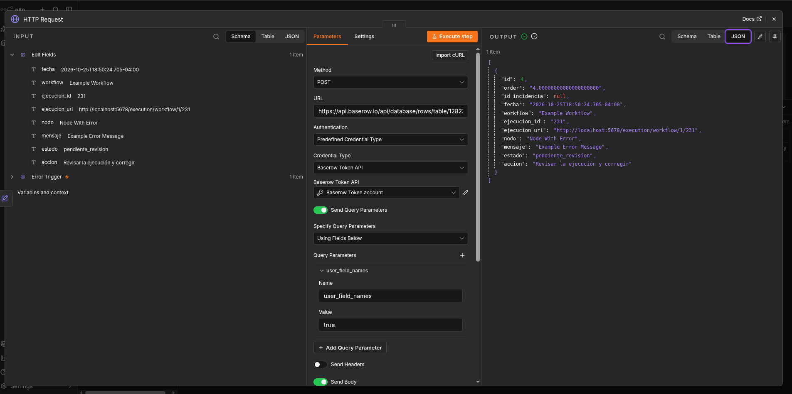

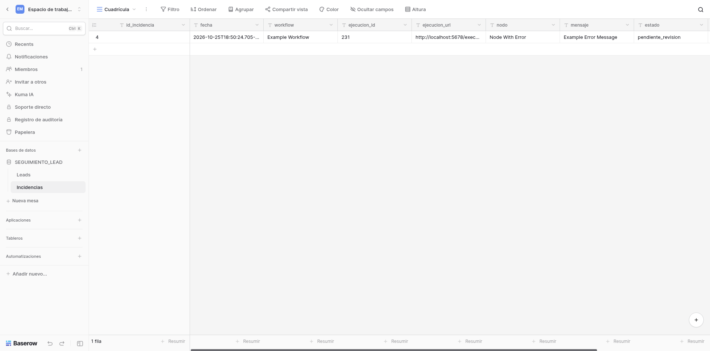

#### P01 — Caso normal: empresarial e interés ALTO

**Entrada:** `Prueba Uno | prueba.uno@empresa.com | ALTO | Quiero agendar una visita`.

**Pasos:** publicar las dependencias y 6.1, iniciar el túnel, enviar el mensaje al bot, consultar la ejecución y buscar el lead en Baserow.

**Esperado:** correo empresarial, `Notificacion inmediata`, fila y confirmación. **Observado:** el subworkflow devuelve `es_empresarial: true`, interés ALTO y la acción; el chat confirma el registro y Baserow muestra la fila 69, canal Telegram y `formMode: test`. La salida del subworkflow conserva `formMode: telegram`, lo que permite observar el reemplazo al guardar. `submittedAt` es `2026-10-25T23:33:26.000Z`.

**Conclusión:** recorrido completo aprobado. El número de ejecución de n8n no es legible en estas capturas; la correlación usa nombre, correo, fecha y registro visible.

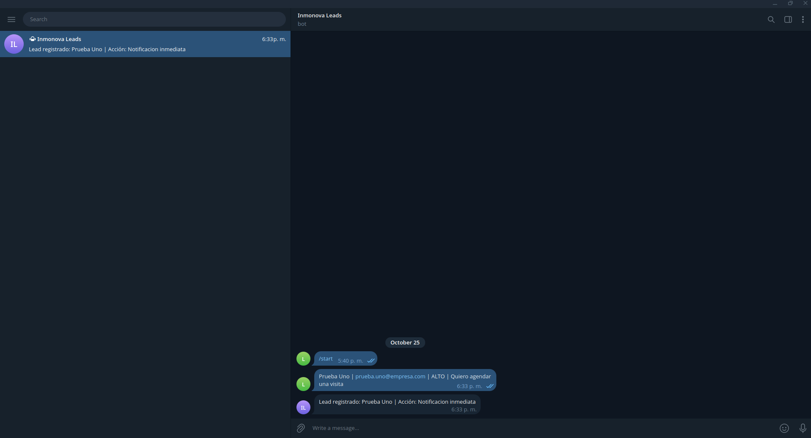

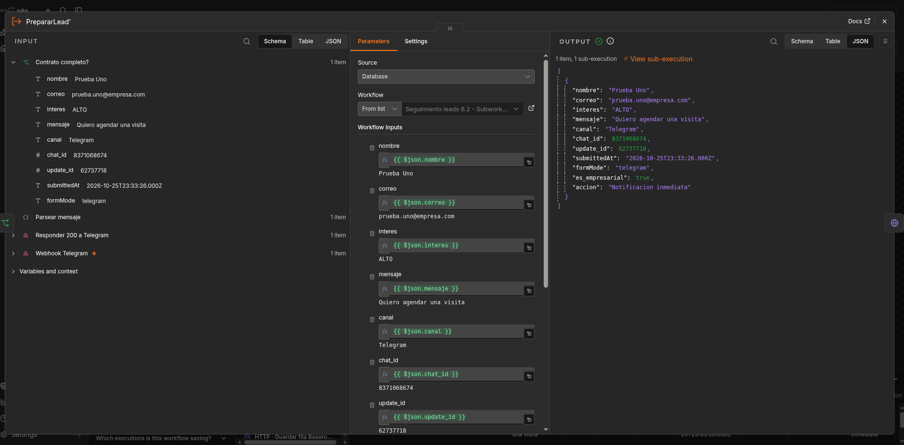

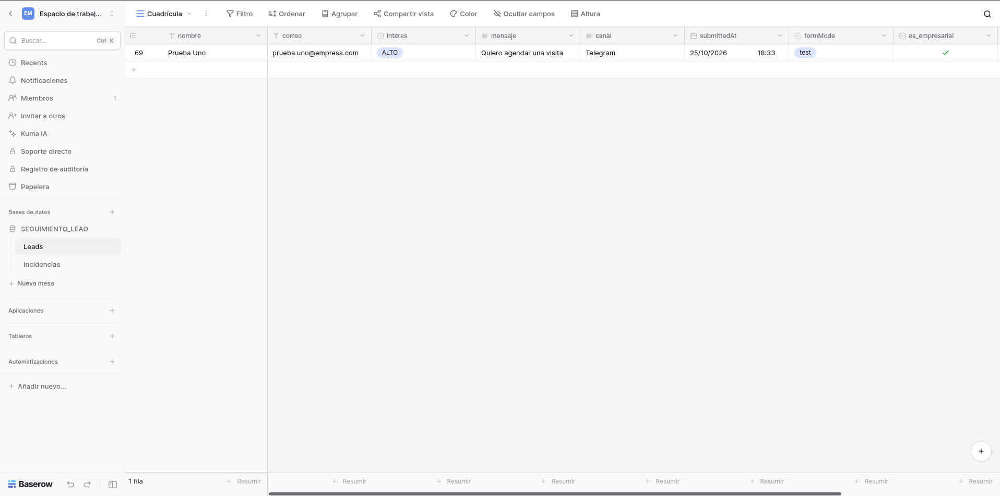

#### P02 — Correo personal e interés ALTO

**Entrada:** `Prueba Dos | prueba.dos@gmail.com | ALTO | Solicito informacion`.

**Pasos:** enviar el mensaje al bot y revisar salida de `PrepararLead'`, chat y tabla de leads.

**Esperado:** `es_empresarial: false`, acción inmediata y registro. **Observado:** el subworkflow devuelve `false` con `Notificacion inmediata`; Baserow muestra la fila 71 con casilla empresarial desmarcada y Telegram confirma. `submittedAt` es `2026-10-25T23:37:51.000Z`.

**Conclusión:** aprobada la ruta de correo personal. La clasificación cambia, mientras que la acción sigue dependiendo del interés.

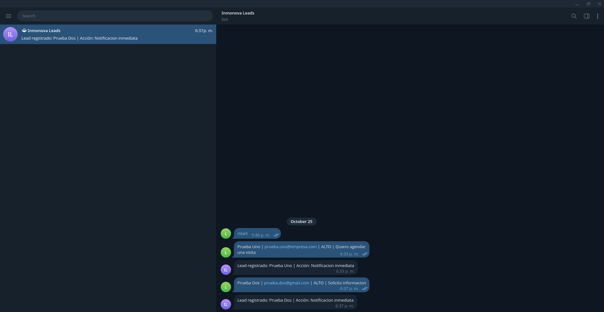

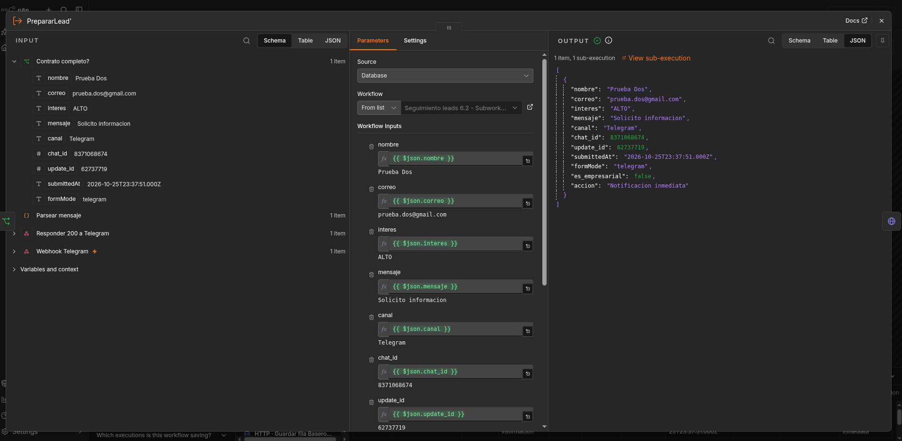

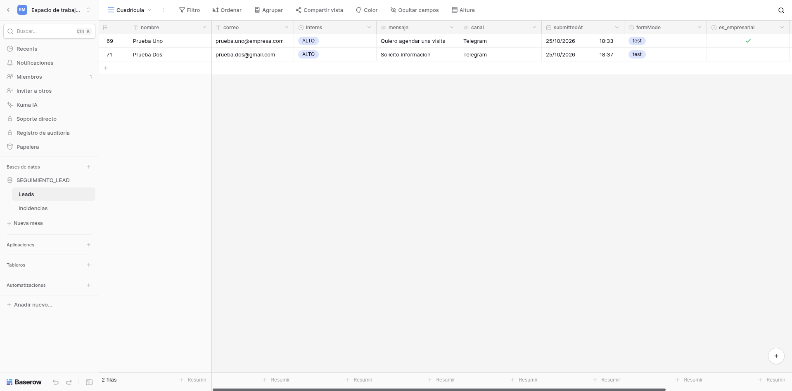

#### P03 — Interés MEDIO

**Entrada:** `Prueba Tres | prueba.tres@empresa.com | MEDIO | Revisare las opciones`.

**Pasos:** enviar por Telegram y comprobar confirmación y fila de destino.

**Esperado:** acción `Registrar seguimiento en 2 o 3 dias`. **Observado:** Telegram devuelve exactamente esa acción y Baserow muestra la fila 72 con interés MEDIO, correo empresarial y mensaje correspondiente. La columna `accion` no está visible en la cuadrícula capturada; su valor está acreditado en la confirmación.

**Conclusión:** aprobados el registro y la acción comunicada. No se programó ni se ejecutó un contacto futuro.

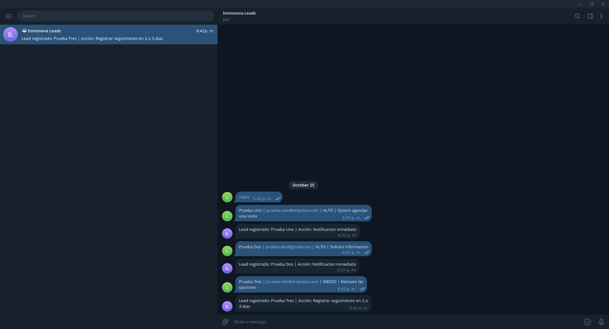

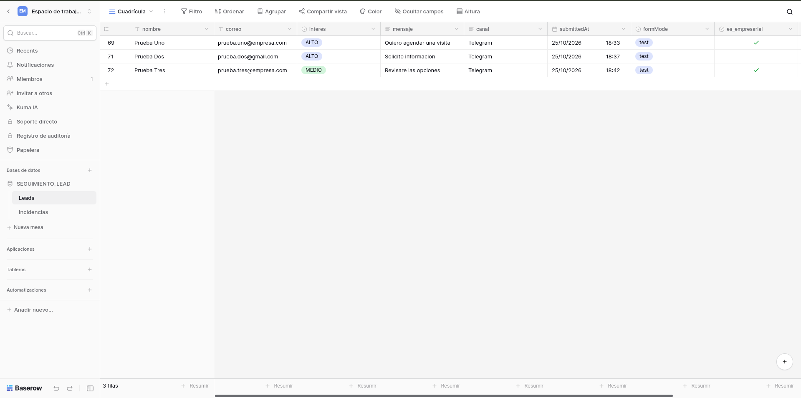

#### P05 — Interés BAJO

**Entrada:** `Prueba Cinco | prueba.cinco@empresa.com | BAJO | Solo estoy consultando`.

**Pasos:** enviar por Telegram y observar la respuesta del bot.

**Esperado:** acción `Archivar, contactar en el futuro`, guardado y confirmación. **Observado:** el chat muestra entrada y confirmación con esa acción. No se recibió un archivo `P05_Baserow.png`; por ello no se presenta el almacenamiento de este caso como verificado visualmente de forma independiente.

**Conclusión:** verificada la selección de acción y su entrega al chat; cobertura parcial del caso integral. No implica archivado efectivo.

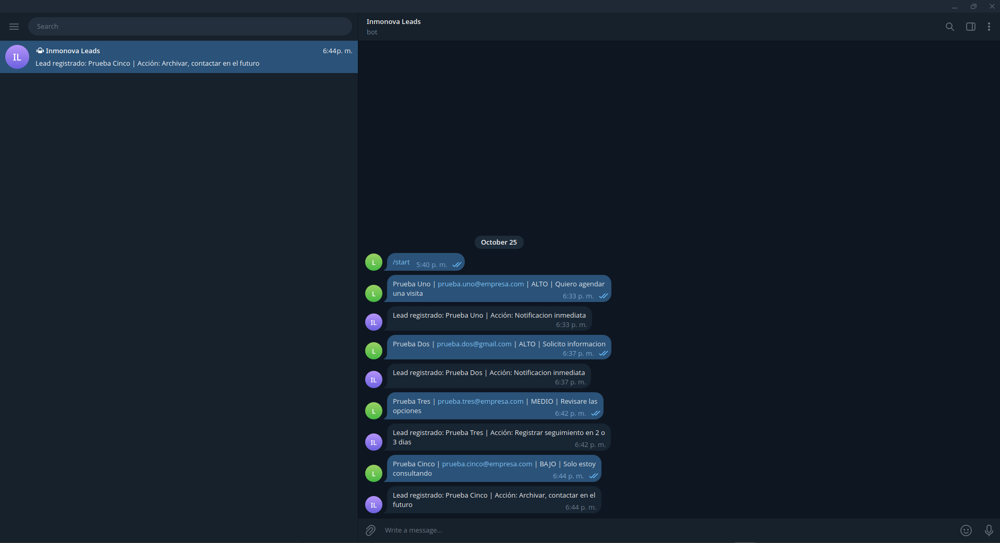

#### P07A — Entrada inválida

**Entrada:** `Prueba Invalida | sin-arroba | ALTO | Visita`.

**Pasos:** enviar por Telegram, revisar el aviso de formato en la ejecución y filtrar el nombre en la tabla de leads.

**Esperado:** rechazo sin crear el lead. **Observado:** el bot devuelve el formato esperado; la ejecución del nodo de aviso recibe el correo `sin-arroba` y Telegram responde `ok: true`, `message_id: 39`. La vista de Baserow muestra «1 filtro» y «Sin filas». La captura de n8n corresponde al nodo de aviso, no al lienzo completo; acredita que se ejecutó la ruta de rechazo. El valor concreto del filtro no está desplegado en la captura.

**Conclusión:** entrada inválida rechazada y aviso entregado, con la limitación visual indicada para la comprobación de ausencia.

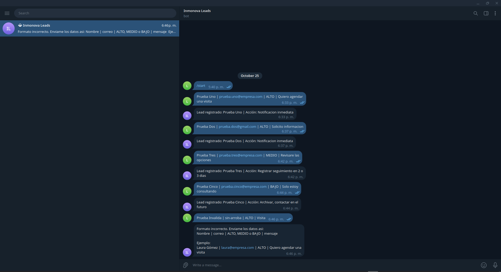

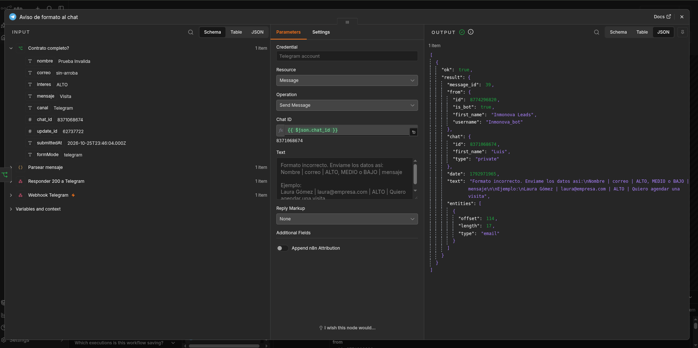

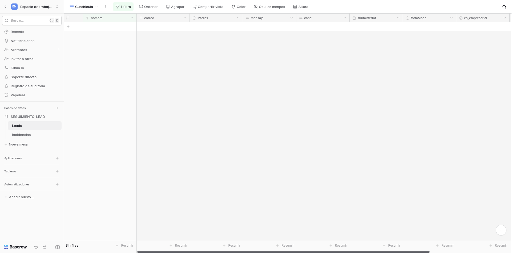

#### P08 — Error local controlado

**Entrada:** `Prueba Error | error@empresa.com | ALTO | Caso de fallo local`, dentro de un update ficticio con `update_id: 900008` y el `chat_id` del participante.

**Preparación y pasos:**

1. Duplicar 6.1 como `Seguimiento leads — Prueba error local`, sin publicar la copia.
2. Cambiar solo el path del Webhook a `tg-leads-prueba`.
3. Conservar la URL correcta del guardado en una nota y sustituirla por `https://api.baserow.io/api/database/rows/table/0/`.
4. Mantener válida la URL y credencial de incidencias.
5. Pulsar **Execute** en el lienzo completo y enviar el update a la URL de prueba con `curl`.

```bash
# Sustituir <CHAT_ID> por el identificador numérico del chat de prueba.
curl -i -X POST "http://localhost:5678/webhook-test/tg-leads-prueba" \
  -H "Content-Type: application/json" \
  -d '{"update_id":900008,"message":{"chat":{"id":<CHAT_ID>},"text":"Prueba Error | error@empresa.com | ALTO | Caso de fallo local"}}'
```

**Esperado:** fallo de guardado tras el reintento configurado, registro local y aviso, sin confirmación de éxito. **Observado:** el guardado entrega `ERROR_TABLE_DOES_NOT_EXIST` por la salida Error; la ruta crea la incidencia **7** y Telegram entrega el aviso de revisión. La captura de respuesta conserva `ejecucion_id: "=60"`. Los dos intentos se encuentran configurados en el JSON, pero las capturas no muestran un registro individual de cada intento.

**Conclusión:** tratamiento local aprobado con observaciones. El flujo termina su ruta prevista aunque el guardado falle; los nodos verdes no convierten el fallo comercial en un registro exitoso. Se confirmó el defecto de formato `=` y el uso de un enlace firmado de reanudación, ocultado en la copia de evidencia para la entrega.

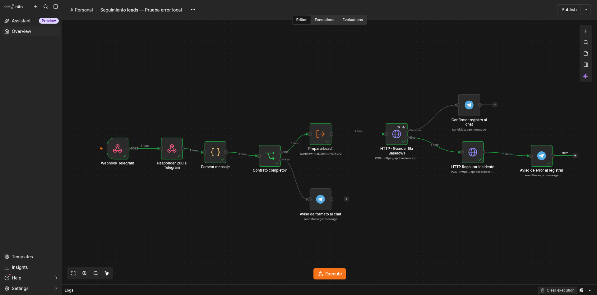

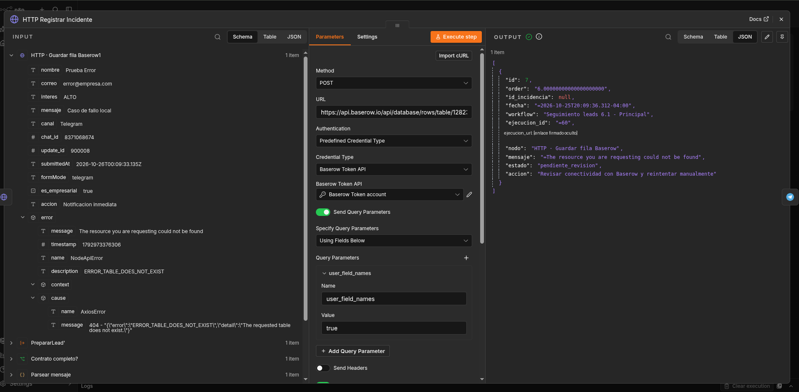

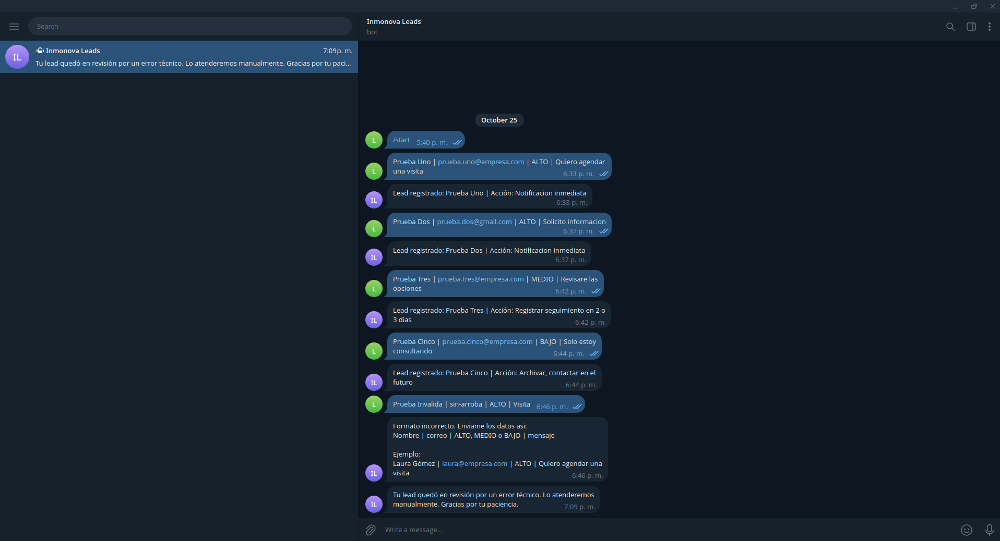

#### P09 — Error automático y manejador global

**Preparación:** 6.3 publicado y seleccionado como Error Workflow en 6.4; `forzar_error` booleano `true` y horario de un minuto.

**Pasos:** publicar 6.4, dejar que el horario produzca el fallo, abrir la ejecución del laboratorio y consultar la ejecución de 6.3. Al terminar la prueba, despublicar 6.4 para detener la generación periódica de fallos.

**Esperado:** fallo intencional y registro de incidencia por el manejador. **Observado:** la ejecución **55** del laboratorio falla en `Stop and Error`, a las **18:58:57** según la cabecera. El manejador crea la fila **5** con `ejecucion_id: "55"`, workflow `Seguimiento leads 6.4 - Lab`, mensaje `Fallo forzado para prueba de Error Trigger` y estado `pendiente_revision`. La fecha del registro es `2026-10-25T19:58:57.087-04:00`, coherente con el desplazamiento horario distinto.

**Conclusión:** aprobada la activación automática y escritura. No hay un archivo separado `P09_Incidencia.png`; la respuesta de creación de Baserow mostrada por el HTTP es la evidencia de persistencia. La captura del laboratorio se tomó publicado durante la prueba; no demuestra por sí sola su estado operativo actual.

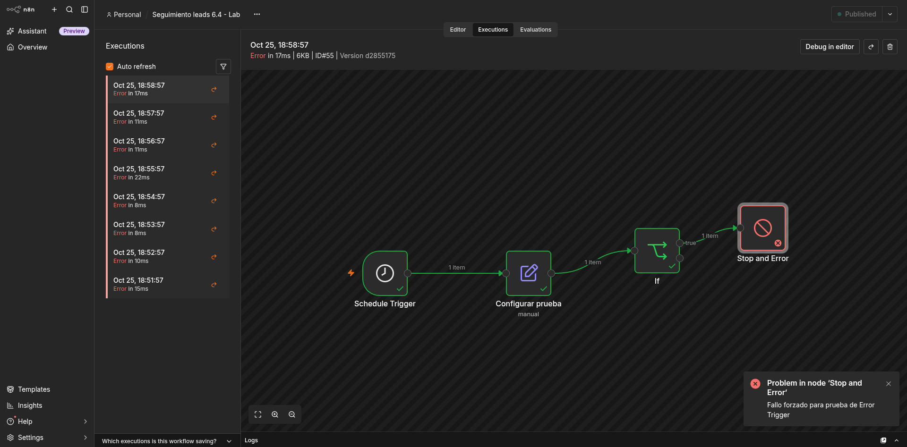

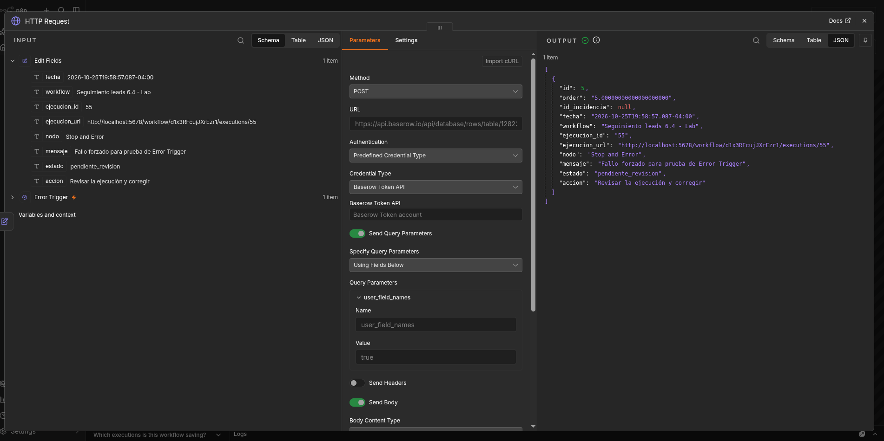

#### P10 — Recuperación manual

**Entrada:** el mismo lead `Prueba Error` de P08.

**Pasos:** revisar el destino antes de repetir, restaurar en la copia la URL correcta de la tabla de leads, guardar, iniciar **Execute** desde el lienzo y repetir el mismo `curl` cuando el Webhook esté escuchando. No publicar la copia.

**Esperado:** creación del lead y confirmación después de corregir la causa. **Observado:** la captura previa muestra una vista filtrada sin filas; la captura final muestra una fila para `Prueba Error`, referencia visible **74**, interés ALTO y correo empresarial. El bot cambia del aviso de revisión de las **19:09** a `Lead registrado: Prueba Error | Acción: Notificacion inmediata` a las **19:14**.

**Conclusión:** recuperación manual aprobada para el caso. La condición del filtro no aparece desplegada en las capturas, por lo que no constituye una auditoría completa de duplicados de toda la tabla. No se afirma idempotencia ni reanudación automática del incidente; tampoco se adjuntó evidencia de cambiar su estado a resuelto.

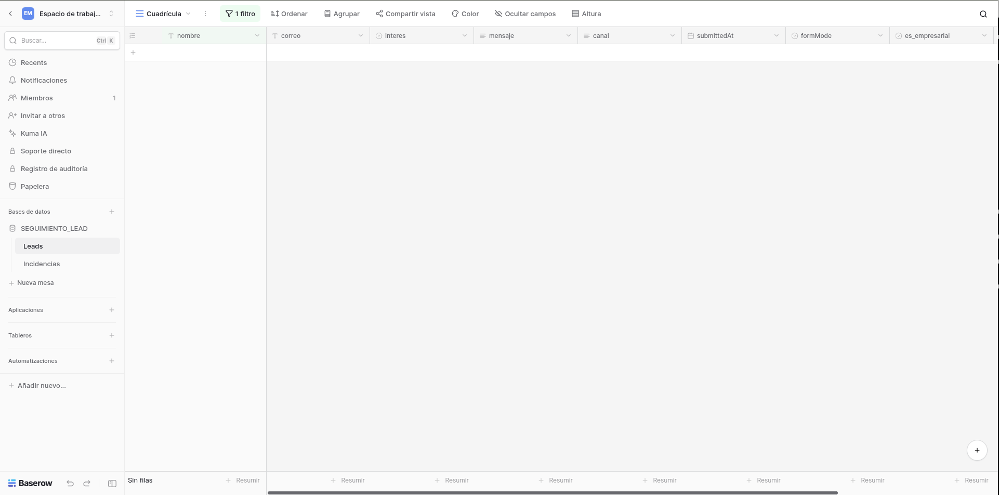

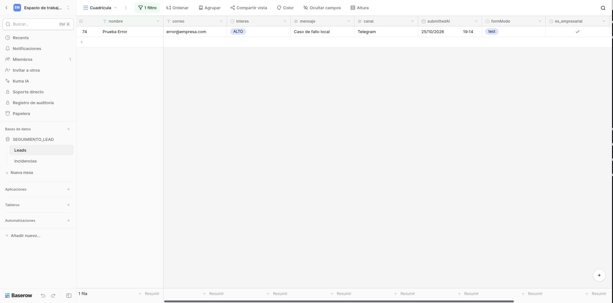

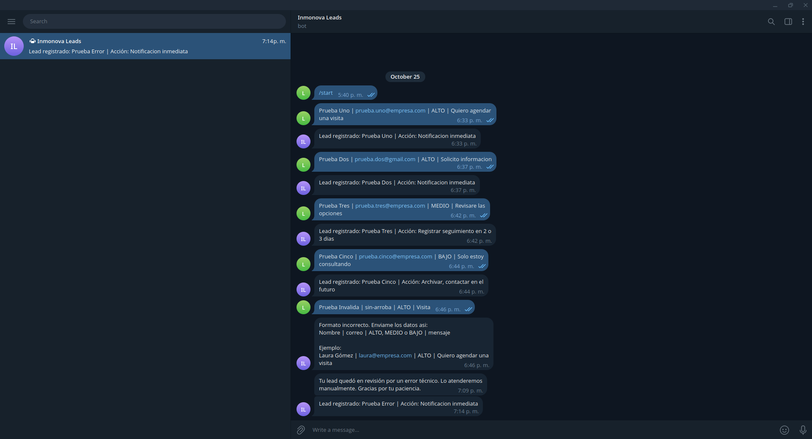

## 9. Evolución, decisiones y dificultades

### 9.1. Evolución comprobable en los archivos

El [diagrama conservado del primer corte](diagramas/Flujo_Manual_Automatizo_Corte_1.jpg) muestra entrada por formulario, normalización, clasificación del correo, decisión por interés y una salida con acción asignada. No se incluyen los JSON de aquellas versiones, por lo que ese diagrama no prueba por sí solo su ejecución histórica.

La versión actual incorpora entrada por Telegram, conectividad mediante túnel, validación previa, separación de la clasificación en 6.2, escritura HTTP en Baserow, respuestas al chat, ruta local de error, manejador global y laboratorio automático. La jornada del 25 de octubre de 2026 documenta estos resultados en la instalación local; no se reconstruyen fechas ni aportes históricos que no estén respaldados por información del equipo.

### 9.2. Decisiones técnicas

- **Telegram como entrada actual:** permite una demostración por mensajes con un formato definido.
- **Respuesta HTTP inmediata:** separa la recepción del evento del resultado posterior del registro.
- **Baserow para datos e incidencias:** centraliza las tablas, aunque crea una dependencia compartida ante una caída del servicio.
- **Subworkflow para la clasificación:** separa reglas del negocio de las integraciones.
- **Errores locales y globales diferenciados:** una operación capturada localmente puede terminar sin activar Error Trigger; un fallo automático no controlado se deriva al manejador asociado.
- **Laboratorio separado:** permite probar Error Trigger sin depender de un mensaje real al bot y mantiene el fallo intencional fuera del principal.

### 9.3. Dificultades y estado de resolución

| Situación | Tratamiento documentado | Estado verificable |
| --- | --- | --- |
| Script no encontrado al invocarlo por nombre | Ejecutar `./iniciar_bot.sh` desde su carpeta. | Resuelto en la sesión de pruebas. |
| Falta de `TG_TOKEN` y de `cloudflared` | Preparar `.env` local e instalar el cliente del túnel. | El script registró el webhook con `ok: true`; pruebas Telegram posteriores exitosas. |
| Referencia al subworkflow de otra instalación | Seleccionar el 6.2 propio y publicarlo antes de 6.1. | Resuelto; salidas acreditadas por P01 y P02. No equivale a una prueba adicional de instalación limpia. |
| `POST tg-leads` no registrado | Publicar dependencias y principal; distinguir URL de prueba y producción. Consultar producción en Executions. | Resuelto; respuesta HTTP 200 y pruebas desde Telegram. |
| `Credentials not found` en Telegram y HTTP | Reasignar credenciales en cada nodo, guardar y publicar los cambios. | Resuelto para los recorridos acreditados. Corregir 6.3 no reasigna automáticamente los nodos de 6.1. |
| `ERROR_NO_PERMISSION_TO_TABLE` | Usar un token Baserow con permiso Create sobre la tabla que realmente indica la URL. | Resuelto; C00 demuestra creación y consulta visual de la fila 4. |
| Manejador gris en Error Workflow | Publicar 6.3 y volver a asociarlo en los ajustes de 6.4. | Resuelto; P09 correlaciona la ejecución 55 y la incidencia 5. |
| Escucha de prueba sin recorrido completo | Ejecutar la copia desde el lienzo y enviar después la petición `curl`. | Resuelto en P08. |
| Formato del registro local | Inspeccionar la respuesta real, no solo el color de los nodos. | Incidencia creada, pero `=` sobrantes, nombre fijo y URL de reanudación quedan como mejoras conocidas. |
| Posibles duplicados | Revisar el destino antes de reenviar. | P10 documenta recuperación manual; no hay deduplicación automática. |

Las opciones exactas de selección de Baserow siguen siendo un requisito de configuración. No se afirma que un error de esas opciones haya ocurrido en esta jornada, porque no se aportó evidencia de ese incidente.

## 10. Aportes y herramientas de apoyo

La distribución general figura en la sección 1. Los aportes comprobados durante esta jornada son:

| Fecha | Integrante | Actividad realizada | Archivo, ejecución o evidencia que la respalda |
| --- | --- | --- | --- |
| 25/10/2026, fecha local | Luis Eduardo Sinisterra Montaño | Configuración local, reasignación de referencias y credenciales, ejecución de casos normales e inválidos, laboratorio automático, fallo local y recuperación; captura y organización de evidencias. | Los 22 archivos de `documentacion/evidencias/`, relacionados en la sección 8. |
| Cierre de la misma jornada | Luis Eduardo Sinisterra Montaño, con apoyo de IA | Solicitud de consolidación de resultados, revisión de capturas y cierre de la bitácora unificada. | Esta bitácora y sus referencias relativas. |

Las funciones de Johan, Javier y Simón se conservan como responsabilidades declaradas; no se les atribuyen ejecuciones concretas sin registro adicional.

Para preparar esta versión se utilizó un asistente de IA en OpenCode como apoyo para revisar el repositorio, contrastarlo con la guía del segundo corte y estructurar la bitácora. La revisión se apoyó en la lectura de los JSON, el README, los diagramas y el material de clase; además, se realizaron las comprobaciones locales descritas en 8.1.

La IA acompañó el diagnóstico y la secuencia de pruebas; Luis ejecutó las acciones en n8n, Telegram y Baserow y aportó las capturas. Para el cierre se revisaron las 22 imágenes y se contrastaron sus valores con las reglas de los JSON. Se conservan expresamente los límites de evidencia de P05, P07A, P09 y P10. La captura P08 se editó únicamente para ocultar el enlace firmado de reanudación, sin alterar el error ni los resultados del registro.

## 11. Estado final y acta de cierre documental

### Implementado en los archivos entregados

Recepción por Webhook, parser, IF de validación, subworkflow de clasificación, POST de creación del lead, confirmación Telegram, reintento limitado, ruta local de incidencias y manejador de errores. Las pruebas acreditan el recorrido normal empresarial y personal, la ruta MEDIO, la respuesta BAJO, el rechazo de correo inválido, la incidencia local, el manejador global y la recuperación manual, con el alcance específico de la matriz final.

### Simulado o destinado a pruebas

Datos ficticios y workflow 6.4 con error forzado. Las acciones comerciales son textos del registro y no tareas ejecutadas. La programación automática del laboratorio se utiliza solo durante su prueba.

### Propuesto y no implementado

Deduplicación por `update_id`, consulta y actualización de leads, validación más completa de correo, agenda automática de seguimiento, WhatsApp Business API y panel de métricas.

### Limitaciones y mejoras conocidas al cierre

- El correo se valida solo por contener `@` y la regla empresarial es una heurística limitada.
- No hay deduplicación automática, agenda de seguimiento ni lectura o actualización de leads desde n8n.
- El aviso local depende del registro de incidencia en el mismo servicio Baserow.
- P08 conserva signos `=` en algunos valores y un nombre de workflow fijo; el enlace obtenido es de reanudación y no de consulta. Se documenta el defecto sin presentarlo como corregido.
- Para BAJO se conserva confirmación Telegram, pero no una captura independiente del almacenamiento. No se ejecutaron todas las combinaciones de correo e interés.
- Las capturas de cuadrícula no muestran la columna `accion` en todos los casos y los filtros no siempre están desplegados. Las conclusiones no exceden lo visible.
- No se realizó una instalación limpia independiente, no se midió carga ni se probaron todos los fallos posibles de los servicios.
- Los JSON conservan IDs y credenciales de la exportación original; las capturas corresponden a la instalación local reconfigurada. La copia de prueba no se incluye como quinto JSON: sus cambios y reproducción están descritos en P08 y P10. Una reexportación de los workflows locales y la actualización del diagrama son tareas del responsable de esos entregables.
- La publicación en GitHub, el acceso del docente y el estado actual de los workflows en n8n no se verificaron desde esta revisión de archivos. Como cierre operativo del laboratorio se indicó despublicar 6.4 y dejar sin publicar la copia de pruebas; las capturas prueban su ejecución, no su estado actual.

### Cierre de la responsabilidad de bitácora y evidencias

Se da por **cerrada documentalmente la bitácora unificada de la jornada de pruebas**, consolidada a solicitud de Luis Eduardo Sinisterra Montaño. El expediente contiene **22 capturas**, una matriz de resultados, los procedimientos de reproducción, las dificultades resueltas, el aporte del responsable y las limitaciones observadas.

La cobertura documentada permite distinguir un lead registrado, una entrada rechazada, un fallo atendido localmente y un fallo automático derivado al manejador. También muestra la recuperación mediante corrección y reenvío. La decisión de cierre se refiere a esta documentación y a sus evidencias disponibles; no declara completados otros entregables del equipo, como el PDF o la actualización de exportaciones.

Los beneficios esperados son menor digitación manual, reglas de clasificación uniformes y mayor trazabilidad. No se reportan porcentajes de ahorro ni mejoras medidas porque no hay una medición adjunta que los respalde.

## 12. Referencias

- [README e instrucciones resumidas](../README.md).
- [Workflows de la versión entregada](../workflows/).
- [Diagramas](diagramas/) y [carpeta de evidencias](evidencias/).
- Guía de entrega del segundo corte, EAM, periodo 2026 II: material académico de referencia revisado por el equipo, no incluido en este repositorio.
- Clase 08: *Subworkflows, manejo de errores y registros*, profesor Robert Garcia Rey: fundamentos y ejemplos académicos de referencia, no incluidos en este repositorio.
- [Documentación oficial de subworkflows de n8n](https://docs.n8n.io/flow-logic/subworkflows/).
- [Documentación oficial de Error Trigger](https://docs.n8n.io/integrations/builtin/core-nodes/n8n-nodes-base.errortrigger/).
